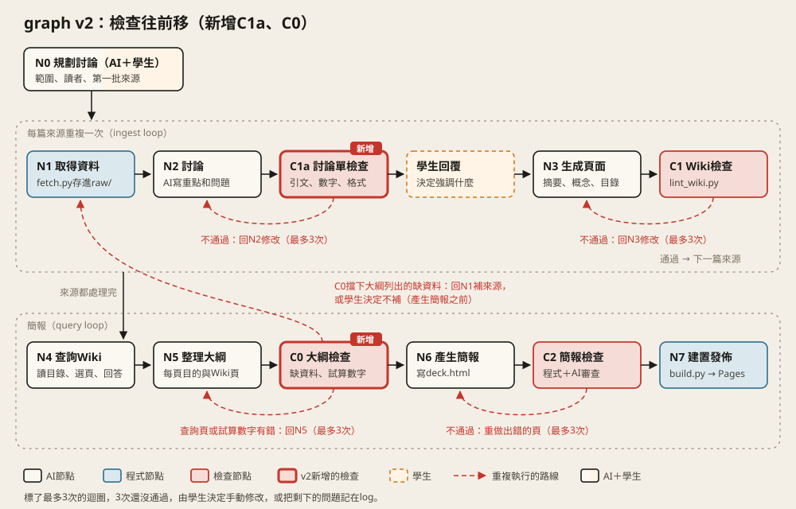
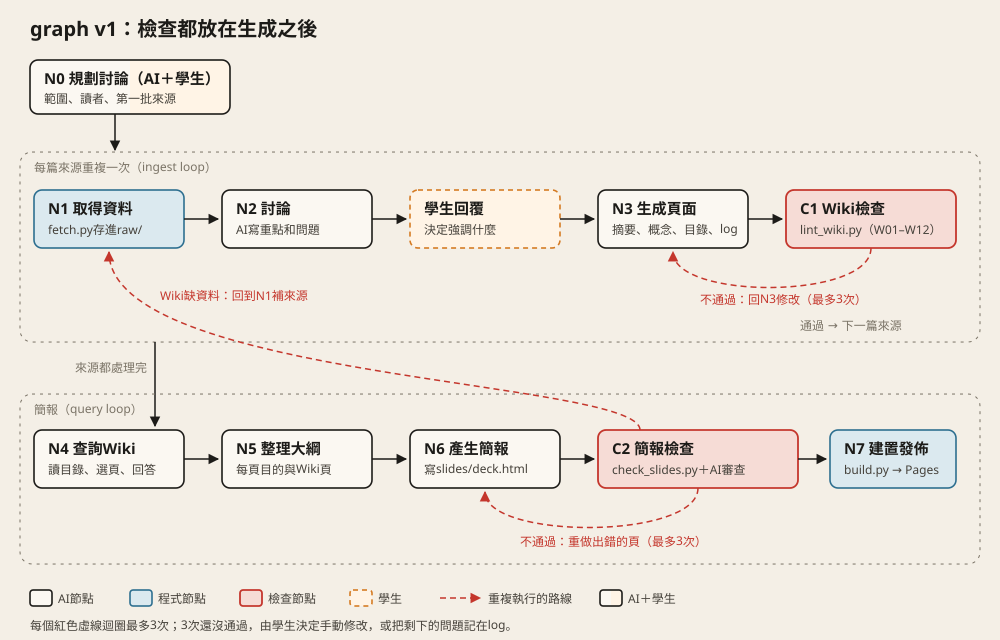

# 流程圖：loop／graph設計

Wiki和簡報都是照這張流程圖做出來的。每個方框是一個節點，紅色虛線是檢查不通過時回去重做的路線。規則細節在 [AGENTS.md](AGENTS.md)，每次照流程圖執行的紀錄在 [run-01](runs/run-01/README.md)、[run-02](runs/run-02/README.md)。

## 目前的流程（graph v2）

| 節點 | 誰做 | 做什麼 | 產出 |
|---|---|---|---|
| N0 規劃討論 | AI、學生 | 定範圍、讀者、第一批來源 | `wiki/discussions/D00-規劃.md` |
| N1 取得資料 | 程式 | 從來源清單取一篇，自動編號Sxx，記SHA-256 | `raw/Sxx-*.md`（之後不改） |
| N2 討論 | AI | 讀新來源和現有Wiki，寫重點、和現有Wiki的關係、想問的問題 | 討論單 `wiki/discussions/Dxx-*.md` |
| C1a 討論單檢查 | 程式 | 引文和原文逐字比對、數字、出處、固定的節 | `runs/run-xx/checks/` |
| 學生回覆 | 學生 | 回答AI的問題，決定要強調什麼、不同說法怎麼處理 | 討論單的「學生回覆」 |
| N3 生成頁面 | AI | 照「決定」新增或修改頁面，更新目錄和log | 來源摘要、概念頁、主題頁 |
| C1 Wiki檢查 | 程式 | 整個Wiki：格式、連結、引文、數字、出處、討論單 | `runs/run-xx/checks/` |
| N4 查詢Wiki | AI | 讀目錄選頁，回答「新手要依序懂哪些事」 | `wiki/queries/Q01-新手學習順序.md` |
| N5 整理大綱 | AI | 把回答排成簡報大綱，列試算數字和Wiki缺的資料 | `wiki/queries/Q02-簡報大綱.md` |
| C0 大綱檢查 | 程式 | 查詢頁的單頁檢查、試算數字在Wiki找得到、缺資料有沒有處理 | `runs/run-xx/checks/` |
| N6 產生簡報 | AI | 只用Wiki的內容寫每一頁，每頁標用到的Wiki頁 | `slides/deck.html` |
| C2a 簡報檢查 | 程式 | 頁面順序、數字和引文在標的Wiki頁找得到、標籤、測驗格式 | `runs/run-xx/checks/` |
| C2b 簡報審查 | 另一個AI | 只讀簡報和它引用的Wiki頁：有沒有依據、意思對不對、新手看不看得懂 | `runs/run-xx/checks/` |
| N7 建置發佈 | 程式 | 合併版型，產生網站 | `docs/` → GitHub Pages |

## 哪些步驟會重複

1. **每篇來源一圈（ingest loop）**：N1→N2→C1a→學生回覆→N3→C1，一次只加一篇。新來源要和現有Wiki比對，所以上一篇的頁面生成、檢查完，才加下一篇。
2. **檢查不通過，回到產生錯誤的節點**：C1a回N2、C1回N3、C0回N5、C2回N6，每個迴圈最多3次。3次還沒通過，由學生決定手動修改，或把剩下的問題記在log。設上限是因為修改常帶出新的錯，一直重生不一定會收斂。
3. **缺資料回N1**：做簡報時發現Wiki沒有需要的資料，就回N1補一篇來源，再走一次ingest loop。v1要到C2審查整份簡報才發現，v2在C0（大綱）就發現。
4. **整張圖再跑一次**：加新來源時從N1開始，Wiki頁、大綱、簡報跟著更新。run-01用v1跑第一批來源，run-02用v2加第二批。

## 檢查放在哪裡、為什麼

- **程式檢查（C1a、C1、C0、C2a）**：抓得到和原文比對就能確認的錯，例如「」裡的字不是原文、數字在原文找不到、出處指到不存在的來源、連結壞掉。每個AI生成節點後面都跑，結果一致，可以重跑很多次。
- **AI審查（C2b）**：程式看不懂意思。另一個AI只讀簡報和簡報引用的Wiki頁，檢查有沒有依據、意思有沒有改掉、新手看不看得懂。
- **學生**：在討論單回答AI的問題；檢查迴圈到3次上限時決定怎麼收尾。
- **錯誤記到產生它的節點**：討論單的AI部分算N2、「學生回覆」算學生、其他Wiki頁算N3、大綱算N5、簡報算N6。每次執行紀錄的最後有統計，才看得出哪個節點最常出錯。

## v1（run-01用的流程）

v1只有兩處檢查：每篇來源生成後的C1，和整份簡報做完後的C2。

## 從v1改成v2

依 [run-01](runs/run-01/README.md) 的檢查紀錄修改：

| run-01發現的問題 | 紀錄裡的數字 | v2的改法 |
|---|---|---|
| N2討論最常出錯，但要等N3生成後的C1才查得到，學生是照著有錯的討論單回覆 | C1抓到的124個錯，66個在討論單（N2） | N2後面加C1a討論單檢查，通過後才給學生回覆 |
| N5大綱沒有檢查，大綱的錯和缺資料要到整份簡報做完才發現 | 大綱的18個錯；缺S波速度，第1版簡報的試算頁空著 | N5後面加C0大綱檢查，缺資料在產生簡報前就回N1 |
| 規則太死，AI為了通過檢查刪掉允許的寫法、加不相關的出處 | 124個錯裡約74個是出處位置、頁碼、來源代號、年份補註 | 放寬這幾種寫法；「」裡不是原文、數字標錯來源照樣檢查 |
| 討論單少了「學生回覆」「決定」兩節，AI回報說有 | 1次 | 加W13檢查固定的節 |
| C2b第2次換了審查AI，又找到第1次漏的錯，也帶出新的意見 | 第2次審查的8個錯，約3個是第1次漏的 | 第一次用新的AI，之後由同一個AI複查 |

<!--RUN02-->
